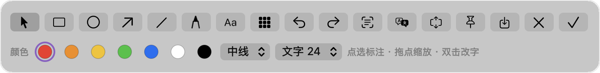

  

# Snaplet

轻量级 macOS 截图与标注工具，中文界面，支持窗口截图、自由框选、滚动长截图、文字识别和图片翻译。

**[⬇ 下载 Snaplet · Mac M 系列](https://github.com/tangxuexx/snaplet/releases/download/v0.1.24/Snaplet-0.1.24-Mac-AppleSilicon.zip) · [使用与安装说明](使用说明.md) · [问题反馈](https://github.com/tangxuexx/snaplet/issues)**

> 本仓库用于发布安装包、使用说明和收集反馈，不包含 Snaplet 应用源码。

## 界面预览

截图后的工具栏：标注、文字识别、图片翻译、长截图、钉图与保存；下方可调整颜色、线条和字号。

## 功能
- 窗口悬停预选与自由框选，支持部分菜单、浮动面板。
- 矩形、椭圆、箭头、直线、画笔、文字、马赛克标注，支持再次编辑和撤销重做。
- 滚动长截图、图片置顶、复制及手动保存 PNG。
- 本机中英文 OCR，支持中英图片翻译。

## 下载与安装
当前提供 **0.1.24 · Apple Silicon（M 系列）Mac** 版本。

1. **[点击下载安装包](https://github.com/tangxuexx/snaplet/releases/download/v0.1.24/Snaplet-0.1.24-Mac-AppleSilicon.zip)**。
2. 解压后将 `Snaplet.app` 拖入“应用程序”文件夹。
3. 打开应用并授权屏幕录制，按 **Option + A** 开始截图。

[查看版本更新记录](https://github.com/tangxuexx/snaplet/releases)

## 系统要求与安装说明
- macOS 14 及以上；图片翻译需要 macOS 15 及以上，首次可能需要下载系统语言包。
- 当前不提供 Intel Mac 或 Windows 安装包。
- 使用本地证书签名，未使用 Apple Developer ID 签名，未经过 Apple 公证。首次打开可能被系统拦截，详见使用说明。
- 长截图在动态内容、复杂侧栏等场景可能出现拼接问题，请检查输出完整性。

无需安装 Codex，无需登录账号。问题和建议欢迎通过 Issues 提交。
