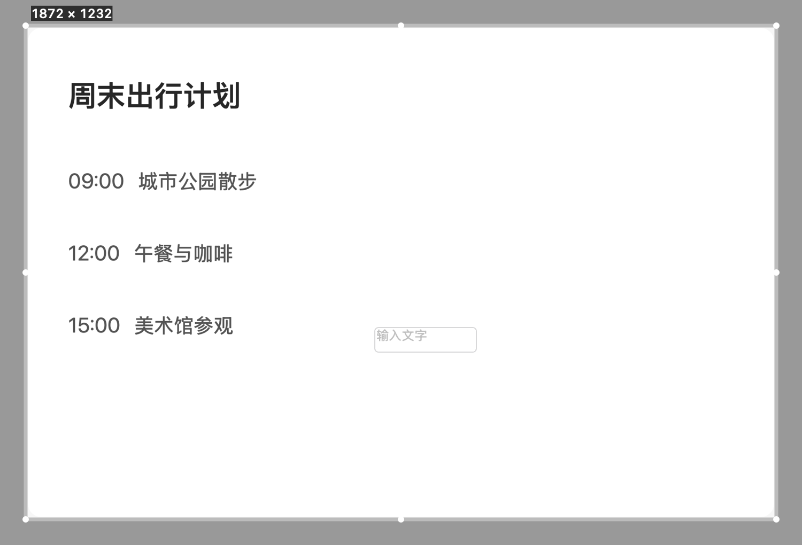

  

# Snaplet

轻量级 macOS 截图与标注工具。截取窗口或任意区域，标注、识别文字、翻译图片，也可以把复制的图片钉在屏幕上随时对照。中文界面，无需登录账号。

**[⬇ 下载 Snaplet · Mac M 系列](https://github.com/tangxuexx/snaplet/releases/download/v0.1.28/Snaplet-0.1.28-Mac-AppleSilicon.dmg) · [使用与安装说明](使用说明.md) · [问题反馈](https://github.com/tangxuexx/snaplet/issues)**

> 本仓库用于发布安装包、使用说明和收集反馈，不包含 Snaplet 应用源码。

## 界面预览

以下为 **0.1.28 正式版**渲染的实际界面，截图内容使用示例素材。

**截图编辑**：自由框选后，可调整选区并添加文字、图形等标注。

**简洁工具栏**：浅色背景与深色图标，当前工具以紧凑的浅灰底色突出显示。

## 功能

- **截图与长截图**：窗口悬停预选、自由框选、滚动长截图；支持部分菜单和浮动面板。
- **标注与编辑**：矩形、椭圆、箭头、直线、画笔、文字、马赛克，支持再次编辑、撤销和重做。
- **钉在屏幕**：将截图或其他应用中复制的图片置顶对照，支持移动、缩放和标注。
- **文字识别与翻译**：本机中英文 OCR，支持中英图片翻译。
- **个性化设置**：分别修改截图和钉图快捷键、自定义选区边框颜色，也可恢复默认；默认边框为中性灰。
- **复制与保存**：一键复制或手动保存 PNG，默认不自动保存截图到桌面。

## 常用快捷键

| 操作 | 默认快捷键 |
| --- | --- |
| 开始截图 | Option + A |
| 钉在屏幕（先复制图片） | Control + Option + P |
| 复制并结束截图 | Enter |
| 保存 PNG | Command + S |
| 撤销 / 重做 | Command + Z / Shift + Command + Z |
| 取消截图 / 关闭钉图 | Esc |

截图和钉图使用独立快捷键，可在菜单栏的 **“设置与使用说明…”** 中修改或恢复默认。鼠标停留在工具栏图标上可查看用途。

## 下载与安装
当前提供 **0.1.28 · Apple Silicon（M 系列）Mac** 版本。

1. **[点击下载安装包](https://github.com/tangxuexx/snaplet/releases/download/v0.1.28/Snaplet-0.1.28-Mac-AppleSilicon.dmg)**。
2. 打开 DMG，将左侧 `Snaplet` 拖到右侧“应用程序”。
3. 打开应用并授权屏幕录制，按 **Option + A** 开始截图。

[查看版本更新记录](https://github.com/tangxuexx/snaplet/releases)

## 更新应用

已有应用内更新功能的用户：点击 **检查更新 → 下载并安装 → 安装并重新启动**。

**0.1.28 沿用 0.1.27 的应用签名：** 从 0.1.27 更新通常无需重新授权录屏。更早版本若尚未完成签名迁移，更新后可能需要在系统设置中重新添加 Snaplet 录屏授权。系统图标可能需要重开设置后刷新。

从 0.1.24 及更早版本升级：先退出旧版，下载安装包，拖入原安装位置并选择“替换”。这次升级后，就可以在菜单栏点击 **“检查更新…”**，下载新版并安装重启。设置中可选择是否自动检查更新。

## 系统要求与安装说明
- macOS 14 及以上；图片翻译需要 macOS 15 及以上，首次可能需要下载系统语言包。
- 当前不提供 Intel Mac 或 Windows 安装包。
- 使用本地证书签名，未使用 Apple Developer ID 签名，未经过 Apple 公证。首次打开可能被系统拦截，详见使用说明。
- 长截图在动态内容、复杂侧栏等场景可能出现拼接问题，请检查输出完整性。

无需安装 Codex，无需登录账号。问题和建议欢迎通过 Issues 提交。
